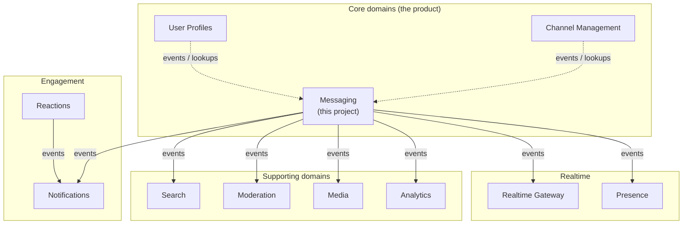

# 1. Domains

Bizcord is the backend of a Discord-like enterprise communication platform. This page splits the platform into **domains** (bounded contexts). Each domain becomes one microservice. The project scope lists four areas (realtime communication, channel management, user profiles, engagement). Here they are broken down further so every service has one clear job.

## The domain map

Reading guide: solid arrows are asynchronous events (see [04-interactions.md](04-interactions.md)). Dotted arrows are information that Messaging only needs for validation or clean-up.

## Why these domains

The split follows the rule from chapters 2 and 3 of *Building Microservices*: group things that **change together** (high cohesion) and keep different reasons to change apart (low coupling).

| Domain | Business question it answers | Why it is separate |
|---|---|---|
| **Messaging** | "What was said, by whom, where, and when?" | Highest write volume. Message rules (length, edit, delete) change independently of everything else. |
| **Channel Management** | "Which workspaces and channels exist, and who may use them?" | Permissions and membership change slowly and are read by many services. |
| **User Profiles** | "Who is this person?" | Identity and profile data have their own privacy rules. |
| **Realtime Gateway** | "Which connected clients should see this right now?" | Deals with long-lived connections and has a very different scaling profile (many idle sockets). |
| **Presence** | "Is this person online or active?" | Fast-changing, low-value data that does not need durable storage. |
| **Notifications** | "Who needs to be told about this?" | Mention rules and delivery preferences are their own logic. |
| **Reactions** | "How did people respond to a message?" | Engagement features grow without touching message storage. |
| **Search** | "Where was that thing mentioned?" | Needs a different data structure (full-text index). |
| **Moderation** | "Does this break the rules?" | Compliance rules change on their own schedule. |
| **Media** | "What files are attached and are they safe?" | Large binary data and virus scanning do not belong in Messaging. |
| **Analytics** | "How is Bizcord used?" | Read-only reporting on top of other services' events. |

## My domain: Messaging

For this assignment I build the **Messaging Service** (Track A in week 40). It is the provider of the system's central event, `MessagePostedEvent`. Everything else in the table above is described on paper only.

- **Ubiquitous language** used in code and docs:
  - *Workspace*: a company's Bizcord space (Discord calls this a "server").
  - *Channel*: a named place inside a workspace where messages are posted.
  - *Message*: one piece of text posted by an author in one channel.
  - *Author*: the user who posted it (referenced by id only).
- The Messaging domain does **not** know what a channel's name is, whether a user is online, or who was mentioned. It only knows ids.

Next: [02-service-responsibilities.md](02-service-responsibilities.md).
