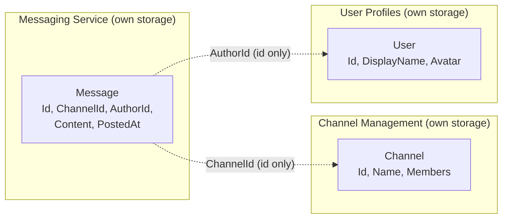

# 3. Boundaries and data ownership

## The rules

1. **One owner per piece of data.** Exactly one service is the source of truth for each entity. Only that service writes to it.
2. **No shared database.** Each service has its own storage. Nobody reads another service's tables.
3. **Reference by id.** A service that needs data from another owner stores the **id** and, if needed, a small local copy (read model) kept up to date by events.
4. **Shared code is contracts only.** The `Shared.Contracts` package contains event types. It contains no business logic.

## Who owns what

| Entity | Owner | Other services hold |
|---|---|---|
| User (name, avatar, email) | User Profiles | `UserId` |
| Workspace | Channel Management | `WorkspaceId` |
| Channel (name, topic, members, permissions) | Channel Management | `ChannelId` |
| **Message** (id, channel id, author id, content, time) | **Messaging** | `MessageId` (Reactions, Search, Moderation, Media, Notifications) |
| Reaction | Reactions | none |
| Attachment (file, scan result) | Media | `AttachmentId` |
| Notification | Notifications | none |
| Presence (online, last active) | Presence | none |
| Search index entry | Search | none |
| Moderation flag | Moderation | none |
| Message counters | Analytics | none |



A dotted arrow is a reference by id. There is no foreign key and no join across services.

## Messaging Service: its data

```
Message
  Id          Guid       generated by the service
  ChannelId   Guid       reference to Channel Management
  AuthorId    Guid       reference to User Profiles
  Content     string     1 to 4000 characters, not blank
  PostedAt    DateTime   UTC, set when created
```

**Invariants** (enforced inside the `Message` domain object, so no code path can skip them):
- `Id` is never `Guid.Empty`.
- `ChannelId` and `AuthorId` are not `Guid.Empty`.
- `Content` is not null, empty or whitespace, and is at most 4000 characters.
- `PostedAt` is set to the current UTC time at creation.

**Storage**: an in-memory repository behind the `IMessageRepository` interface for now. A real database can replace it later without touching the controller or the domain.

## What crosses the boundary

| What | Direction | Contents | Why not more? |
|---|---|---|---|
| `MessagePostedEvent` | Messaging to anyone | `MessageId`, `ChannelId`, `AuthorId`, `Content`, `PostedAt` | Enough for consumers to do their job without calling back. No user names or channel names, those belong to other owners. |
| Channel lookup | Messaging to Channel Management (optional) | Request: channel id. Response: exists or not | Messaging needs only a yes or no. |

## Consistency

Services are **eventually consistent**. When a message is posted:
1. The Messaging Service saves it and answers `201 Created`.
2. Moments later the consumers react. Search may take a second to show the message, and a notification may arrive slightly later.

This is acceptable for chat. It is what lets each service be deployed, scaled and fail on its own.

**What if the broker is down at publish time?** Publisher confirms are on, so the publish fails loudly (the request returns an error) instead of losing the event silently. But the message is already saved, so it exists without an event. This is a known gap in the simple design (the "dual write" problem). The standard fix, the transactional outbox pattern, is out of scope for this assignment.

Next: [04-interactions.md](04-interactions.md).
