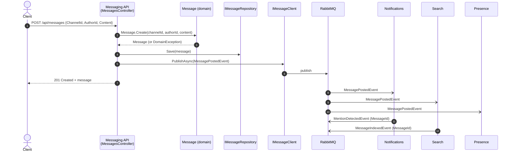
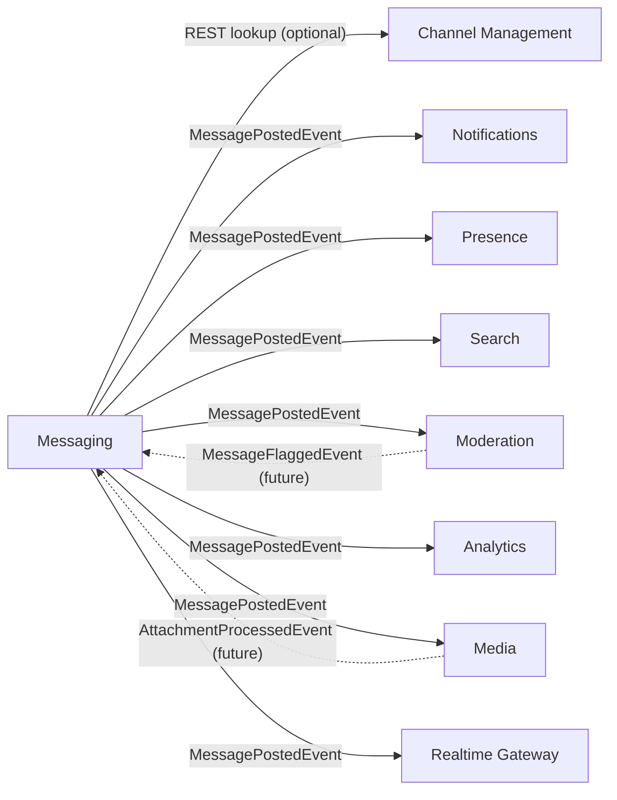

# 4. Interactions between services

## Synchronous or asynchronous?

| Interaction | Style | Reason |
|---|---|---|
| Client posts a message | Synchronous REST (`POST /api/messages`) | The user needs an answer: saved or rejected. |
| Messaging tells the world about the message | **Asynchronous event** | Messaging should not wait for, or know about, consumers. |
| Messaging checks that the channel exists (optional) | Synchronous REST | Needs an immediate yes or no before saving. Costs temporal coupling to Channel Management, so it is optional and configurable. |
| Consumers reacting (mentions, index, flags, counts) | Asynchronous events | They can be slow or down without affecting the sender. |

## Message flow: posting a message

Swimlane view. Each participant is a lane. Time runs top to bottom.

Notes:
- Steps 1 to 7 are the Messaging Service (implemented). Steps 8 to 12 are design only.
- If `Message.Create` throws a `DomainException` the API answers `400 Bad Request` and nothing is saved or published.

## Event catalog

Events are plain classes in `packages/Shared.Contracts`. Only `MessagePostedEvent` is implemented. The others show how the rest of the system would connect.

| Event | Published by | Consumed by | Key fields | Status |
|---|---|---|---|---|
| `MessagePostedEvent` | Messaging | Notifications, Presence, Search, Moderation, Analytics, Media, Realtime Gateway | `MessageId`, `ChannelId`, `AuthorId`, `Content`, `PostedAt` | **Implemented** |
| `MentionDetectedEvent` | Notifications | Realtime Gateway | `MessageId`, mentioned `UserId`s, `ProcessedAt` | Proposed |
| `MessageIndexedEvent` | Search | none | `MessageId`, `IndexedAt` | Proposed |
| `MessageFlaggedEvent` | Moderation | Messaging, Notifications | `MessageId`, `Reason`, `FlaggedAt` | Proposed |
| `AttachmentProcessedEvent` | Media | Messaging | `MessageId`, `AttachmentIds`, `ProcessedAt` | Proposed |
| `ReactionAddedEvent` | Reactions | Notifications, Analytics, Realtime Gateway | `MessageId`, `UserId`, `Emoji` | Proposed |
| `ChannelDeletedEvent` | Channel Management | Messaging, Reactions, Search | `ChannelId` | Proposed |
| `UserDeletedEvent` | User Profiles | Channel Management, Messaging | `UserId` | Proposed |

**Convention:** every result event carries the `MessageId` it relates to, so a message can be traced through the whole system.

### The contract for `MessagePostedEvent`

| Field | Type | Promise from Messaging (provider) |
|---|---|---|
| `MessageId` | `Guid` | Never empty. Unique per message. |
| `ChannelId` | `Guid` | The channel the client asked for. |
| `AuthorId` | `Guid` | The author the client sent. |
| `Content` | `string` | Exactly the saved content. Never null or blank. |
| `PostedAt` | `DateTime` (UTC) | Time of creation, close to now. |

The shared project guarantees the **shape** at compile time. Contract tests guarantee the **values** (see [05-messaging-service-design.md](05-messaging-service-design.md)).

## Who depends on whom

Arrows point from caller to callee (for the REST lookup) and from publisher to consumer (for events). Dotted arrows are future work.

Next: [05-messaging-service-design.md](05-messaging-service-design.md).
