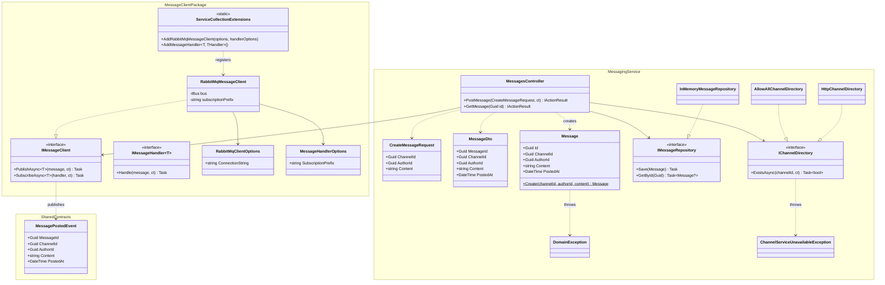

# 5. Messaging Service design

This page is the map of the code. It shows where each class lives and how the pieces connect.

## Repository layout

```
.
├── apps/
│   └── messaging-microservice/
│       ├── src/                      the service (ASP.NET Core Web API)
│       ├── tests/                    unit, contract, service and integration tests
│       ├── Dockerfile
│       ├── docker-compose.yml        RabbitMQ + the service
│       └── README.md
├── packages/
│   ├── MessageClient/                IMessageClient + RabbitMQ (EasyNetQ) adapter
│   └── Shared.Contracts/             events shared between services
└── docs/                             this analysis and design
```

## Class diagram



### How to read it

- **Top-level rule:** the controller depends only on **interfaces** (`IMessageClient`, `IMessageRepository`, `IChannelDirectory`). Replacing RabbitMQ, the storage, or the channel check never touches the controller.
- `IMessageClient` is the **only** place that knows about RabbitMQ. No EasyNetQ type appears in its signature, so a Kafka adapter would implement the same interface.
- `Message` is a domain object with a factory method, `Message.Create`, which enforces the rules (see [03](03-boundaries-and-data-ownership.md)). The controller cannot build an invalid message.

## REST API

| Method and path | Request | Success | Errors |
|---|---|---|---|
| `POST /api/messages` | `{ "channelId": guid, "authorId": guid, "content": string }` | `201 Created` + `MessageDto`, `Location` header points to `GET` | `400` invalid input (`DomainException`), `404` channel unknown (only if the channel check is enabled), `503` Channel service unreachable (same condition) |
| `GET /api/messages/{id}` | none | `200` + `MessageDto` | `404` unknown id |
| `GET /health` | none | `200 Healthy` | none |

## Test strategy

Many small, fast tests and fewer wide ones (the test pyramid). The contract tests are the most important, because they protect the other teams.

| Level | What it checks | Real | Faked | Where |
|---|---|---|---|---|
| **Unit** (domain) | `Message.Create` sets all fields and rejects bad input | `Message` | nothing | `tests/` |
| **Unit** (controller, Moq) | Controller saves, then publishes, and returns 201. Does not publish when the domain rejects | Controller | `IMessageRepository`, `IMessageClient` (Moq mocks) | `tests/` |
| **Provider contract** | The published `MessagePostedEvent` has every field, with correct values, not only the right type | Whole service | Broker replaced by `FakeMessageClient` that captures events | `tests/` |
| **Service test** (WireMock) | The Messaging Service behaves correctly when the Channel service answers 200, 404, 500 | Whole service | Channel service is a WireMock stub (HTTP) | `tests/` |
| **Integration** | Full round trip with **real RabbitMQ**: `POST` then the event arrives on the broker | Whole service and broker | nothing | `tests/` (needs Docker) |

Mocks versus stubs: the Moq controller tests are **mocks** (they verify that `Save` and `PublishAsync` were called). The WireMock tests use **stubs** (canned answers from the Channel service).

## Where the code is

| Part | File |
|---|---|
| Domain rules | `apps/messaging-microservice/src/Domain/Message.cs` |
| Interfaces (`IMessageRepository`, `IChannelDirectory`) | `apps/messaging-microservice/src/Domain/` |
| In-memory storage, channel directories | `apps/messaging-microservice/src/Infrastructure/` |
| REST endpoints and DTOs | `apps/messaging-microservice/src/Controllers/` |
| Wiring (DI) | `apps/messaging-microservice/src/Program.cs` |
| Event contract | `packages/Shared.Contracts/Events/MessagePostedEvent.cs` |
| Message client | `packages/MessageClient/` |
| Tests | `apps/messaging-microservice/tests/` (see its README for the table) |

## Configuration

| Setting | Where | Default | Used for |
|---|---|---|---|
| `RABBITMQ_HOST` | environment variable | `localhost` | RabbitMQ host name. In Compose it is `rabbitmq`. |
| `ChannelService__BaseUrl` | environment variable | not set | If set, enables the channel check against this URL. If not set, every channel id is accepted. |

Next: [06-work-plan.md](06-work-plan.md).
