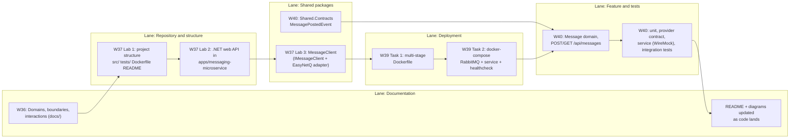

# 6. Work plan: weeks and deliverables

Use this page to navigate the repository: what was delivered in each course week, and where to find it.

## Swimlane: what is delivered, by whom, when

Each lane is an area of the project. Each box is a deliverable. Arrows show what builds on what.

## Where to find each task

| Task | Week | What to look at |
|---|---|---|
| 1. Analysis and design | 36 | `docs/01` to `docs/06` |
| 2a. Setup and boilerplate | 37 | `apps/messaging-microservice/` (`src/`, `tests/`, `Dockerfile`, `README.md`) |
| 2b. Message client | 37 | `packages/MessageClient/` |
| 4. Deployment | 39 | `apps/messaging-microservice/Dockerfile`, `docker-compose.yml`, `.dockerignore` |
| 5. First feature and testing | 40 | `packages/Shared.Contracts/`, `apps/messaging-microservice/src/` and `tests/` |

## Files that several weeks touch

Because the weeks build on each other, these files changed more than once.

| File | Changed in |
|---|---|
| `apps/messaging-microservice/src/Program.cs` | W37 (boilerplate), W37 (register message client), W40 (register repository and handlers) |
| `apps/messaging-microservice/src/Messaging.csproj` | W37, W37 (package refs), W40 |
| `apps/messaging-microservice/README.md` | W37, W37 (message client), W39, W40 |
| `apps/messaging-microservice/Dockerfile` | W39, W40 (copy `Shared.Contracts`) |
| `Bizcord.sln` | W37 and W40 |
| `docs/05-messaging-service-design.md` | W36 (plan), W40 (reconciled with real code) |
