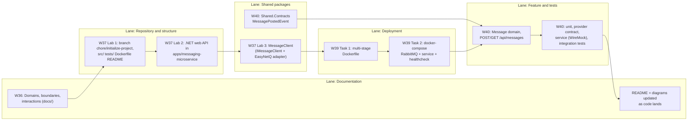
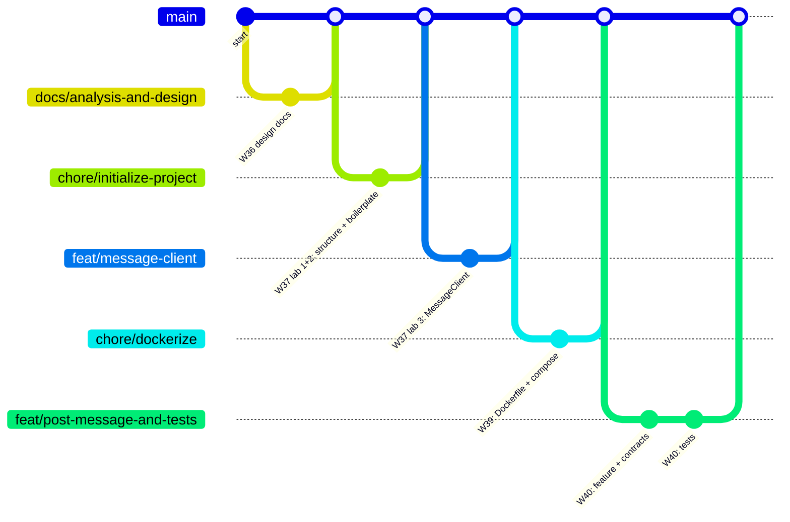

# 7. Work plan: weeks, branches and deliverables

Use this page to navigate the repository. Each course week has its own branch, merged into `main` with a merge commit so the history shows the work per week.

## Swimlane: what is delivered, by whom, when

Each lane is an area of the project. Each box is a deliverable. Arrows show what builds on what.

## Branch and merge order

## Where to find each task

| Task | Week | Branch | What to look at |
|---|---|---|---|
| 1. Analysis and design | 36 | `docs/analysis-and-design` | `docs/01` to `docs/07` |
| 2a. Setup and boilerplate | 37 | `chore/initialize-project` | `apps/messaging-microservice/` (`src/`, `tests/`, `Dockerfile`, `README.md`) |
| 2b. Message client | 37 | `feat/message-client` | `packages/MessageClient/` |
| 4. Deployment | 39 | `chore/dockerize` | `apps/messaging-microservice/Dockerfile`, `docker-compose.yml`, `.dockerignore` |
| 5. First feature and testing | 40 | `feat/post-message-and-tests` | `packages/Shared.Contracts/`, `apps/messaging-microservice/src/` and `tests/` |

Study material (chapter summaries and small demos) is in `study/`. It is separate from the assignment.

## Files that several weeks touch

Because the weeks build on each other, these files change more than once. The merge order above avoids conflicts, since each branch starts from the latest `main`.

| File | Changed in |
|---|---|
| `apps/messaging-microservice/src/Program.cs` | W37 (boilerplate), W37 (register message client), W40 (register repository and handlers) |
| `apps/messaging-microservice/src/Messaging.csproj` | W37, W37 (package refs), W40 |
| `apps/messaging-microservice/README.md` | W37, W37 (message client), W39, W40 |
| `apps/messaging-microservice/Dockerfile` | W39, W40 (copy `Shared.Contracts`) |
| `Bizcord.sln` | W37 and W40 |
| `docs/05-messaging-service-design.md` | W36 (plan), W40 (reconciled with real code) |
