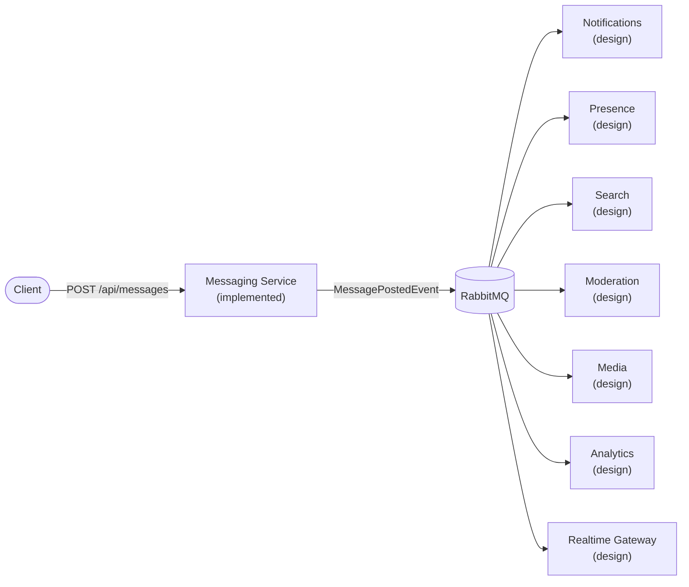

# Bizcord analysis and design

Documentation for the Messaging microservice of **Bizcord**, a Discord-like enterprise communication platform (backend only). This is the deliverable for Task 1 (week 36) and doubles as the map of the repository.

## Start here (10-minute read)

| Order | Page | Answers |
|---|---|---|
| 1 | [01-domains.md](01-domains.md) | What are the domains and which one do I own? |
| 2 | [02-service-responsibilities.md](02-service-responsibilities.md) | What does each service do, and not do? |
| 3 | [03-boundaries-and-data-ownership.md](03-boundaries-and-data-ownership.md) | Who owns which data? What crosses a boundary? |
| 4 | [04-interactions.md](04-interactions.md) | How do services talk? Event catalog, message flow (swimlane) |
| 5 | [05-messaging-service-design.md](05-messaging-service-design.md) | Class diagram, REST API, test strategy |
| 6 | [06-decisions.md](06-decisions.md) | Why these choices, and known limitations |
| 7 | [07-work-plan.md](07-work-plan.md) | Swimlane of the weeks, branches, where to find things |

## One-picture summary

The diagrams use [Mermaid](https://mermaid.js.org/), which GitHub renders directly in the browser.
